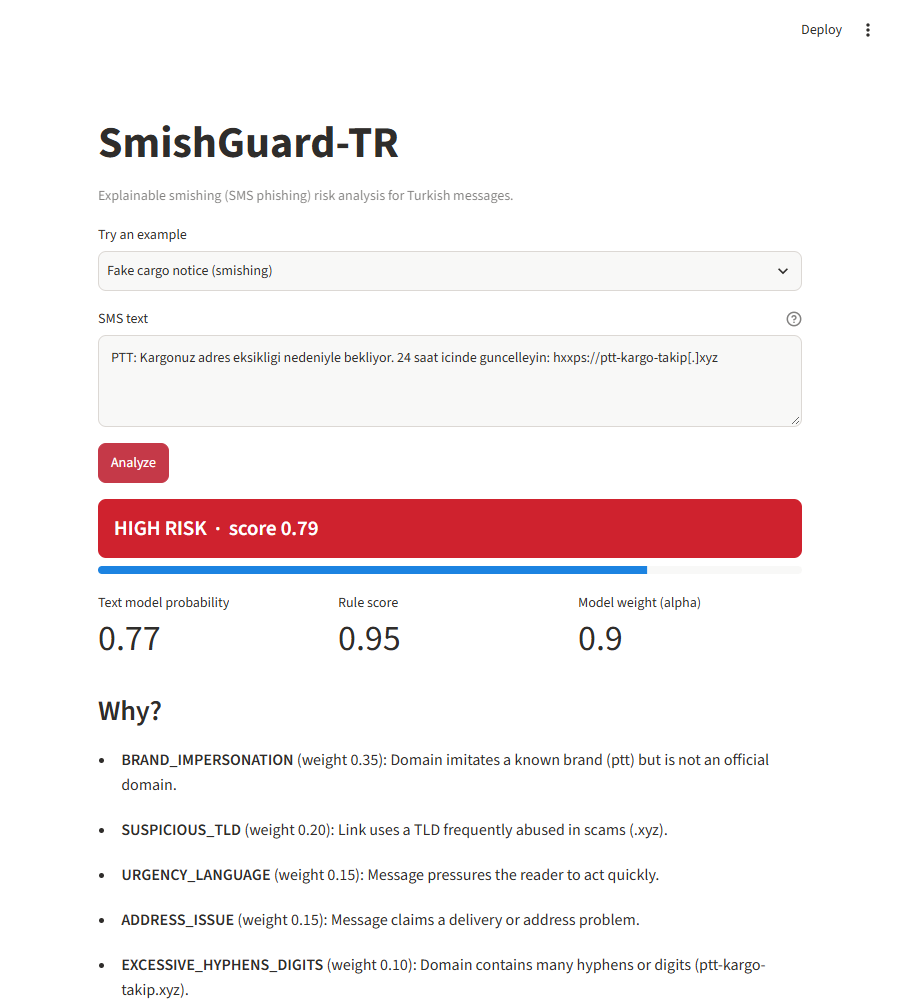
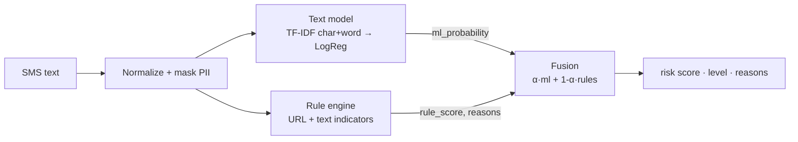
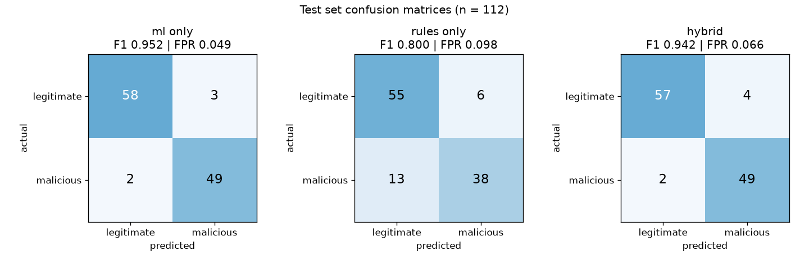

# SmishGuard-TR

[](https://github.com/emirkabacali/smishguard-tr/actions/workflows/ci.yml)
[](reports/coverage.json)
[](pyproject.toml)
[](LICENSE)

Explainable smishing (SMS phishing) risk analysis for Turkish messages.
Hybrid approach: a TF-IDF + Logistic Regression text model fused with an interpretable rule
engine. For every message it returns a **risk score (0–1)**, a **risk level**
(low / medium / high) and **human-readable reasons**.

> Research / portfolio project — **not** a production security product.

## Demo



## Why this project

Fake cargo notices, e-Devlet refunds, HGS/OGS fines, bank alerts and "you won a prize"
messages are a daily nuisance in Turkey. Most published Turkish work classifies SMS as
spam / not spam from the text alone, without saying **why** a message is suspicious and
without looking at the **link** it contains (brand look-alike domains, URL shorteners, cheap
TLDs). SmishGuard-TR adds both: an explanation for every decision and offline URL analysis.

## How it works



- **Normalization:** Unicode NFC, Turkish-aware lowercasing (`I → ı`, `İ → i`, which
  Python's `str.lower()` gets wrong), refanging of `hxxps://a[.]xyz`-style links, masking of
  phone numbers, IBANs, identity numbers and e-mails.
- **Text model:** TF-IDF over character 2–5-grams (robust to Turkish suffixes, typos and
  missing Turkish letters) and word 1–2-grams, classified by a class-balanced Logistic
  Regression.
- **Rule engine:** 11 rules, each with a weight and a message — brand impersonation, URL
  shorteners, suspicious TLDs, IP-address links, punycode, many hyphens/digits, urgency,
  money/fines, credential requests, prizes and delivery problems. Links are parsed offline
  with `tldextract` and **never visited**.
- **Fusion:** `risk = α · ml_probability + (1 − α) · rule_score`; α and the level thresholds
  are tuned on the validation set (α = 0.9, medium ≥ 0.5, high ≥ 0.65).
- One `Analyzer` class serves both the REST API and the demo UI.

More detail: [docs/architecture.md](docs/architecture.md) and the decision log
[docs/DECISIONS.md](docs/DECISIONS.md).

## Results

Test set: 112 real TurkishSMS messages (61 legitimate, 51 malicious), never used for
training or tuning. Each system's threshold (and the hybrid's α) was chosen on the
validation set; the test set was evaluated once. 95% confidence intervals are percentile
bootstrap estimates (1,000 resamples). Source: [`reports/metrics_test.json`](reports/metrics_test.json).

<!-- results:start -->
| System | Precision | Recall | F1 | False positive rate | F1 95% CI |
|---|---:|---:|---:|---:|---|
| ML only | 0.9423 | 0.9608 | 0.9515 | 0.0492 | 0.9032 – 0.9903 |
| Rules only | 0.8636 | 0.7451 | 0.8000 | 0.0984 | 0.7021 – 0.8843 |
| Hybrid | 0.9245 | 0.9608 | 0.9423 | 0.0656 | 0.8846 – 0.9825 |
<!-- results:end -->



**How to read this honestly**

- The hybrid system is **one message worse** than the text model alone (one extra false
  positive). The confidence intervals overlap almost completely, so the data cannot tell the
  two apart. The hybrid is kept because it explains its decisions and covers modern URL
  patterns ([D-011](docs/DECISIONS.md#d-011-keep-the-hybrid-system-although-ml-only-scored-marginally-higher-on-test)).
- The real messages are from 2010–2011 and are mostly advertising spam: **no URL rule fires
  on the test set at all**. The URL rules are exercised by synthetic examples and unit tests
  only.
- Most errors are legitimate institutional messages that look like scams (a bank password
  notice, a real cargo notice). Details: [`reports/error_analysis.md`](reports/error_analysis.md).

## Quickstart

```bash
git clone https://github.com/emirkabacali/smishguard-tr.git
cd smishguard-tr
python -m venv .venv
# Windows: .venv\Scripts\activate    Linux/macOS: source .venv/bin/activate
pip install -e ".[dev]"             # API only: pip install -e .

python scripts/download_data.py     # TurkishSMS (academic license, not in the repo)
python scripts/build_dataset.py     # clean, mask PII, deduplicate, split
python scripts/train.py             # train + compare models on validation
pip install -e ".[eval]"
python scripts/evaluate.py          # tune fusion on validation, evaluate on test

uvicorn smishguard.api.main:app --reload      # API docs: http://localhost:8000/docs
pip install -e ".[demo]"
streamlit run app/streamlit_app.py            # demo UI
```

## API

`POST /v1/analyze` analyzes one message (1–1000 characters):

```bash
curl -X POST http://localhost:8000/v1/analyze \
  -H "Content-Type: application/json" \
  -d '{"text": "PTT: Kargonuz adres eksikligi nedeniyle bekliyor. 24 saat icinde guncelleyin: hxxps://ptt-kargo-takip[.]xyz"}'
```

```json
{
  "risk_score": 0.7879,
  "risk_level": "high",
  "ml_probability": 0.7699,
  "rule_score": 0.95,
  "reasons": [
    {"code": "BRAND_IMPERSONATION", "weight": 0.35,
     "message": "Domain imitates a known brand (ptt) but is not an official domain."},
    {"code": "SUSPICIOUS_TLD", "weight": 0.2,
     "message": "Link uses a TLD frequently abused in scams (.xyz)."},
    {"code": "URGENCY_LANGUAGE", "weight": 0.15,
     "message": "Message pressures the reader to act quickly."},
    {"code": "ADDRESS_ISSUE", "weight": 0.15,
     "message": "Message claims a delivery or address problem."},
    {"code": "EXCESSIVE_HYPHENS_DIGITS", "weight": 0.1,
     "message": "Domain contains many hyphens or digits (ptt-kargo-takip.xyz)."}
  ],
  "model_version": "0.5.0"
}
```

`GET /health` returns `200` when the model is loaded and `503` otherwise; invalid input
returns `422`. `model_version` identifies the trained model artifact, which has not changed
since release 0.5.0.

### Docker

The image holds the code and pinned core dependencies only; the trained model is mounted at
runtime because it is derived from academically licensed data.

```bash
docker build -t smishguard .
docker run -p 8000:8000 -v "$(pwd)/models:/app/models:ro" smishguard
```

Without the dataset, `python scripts/train_demo_model.py --output demo-models` creates a tiny
demo model (smoke tests only; its scores are not meaningful).

## Project structure

```text
smishguard-tr/
├── app/streamlit_app.py        # demo UI
├── data/curated/               # synthetic + curated examples (defanged, anonymized)
├── docs/                       # architecture, decision log, screenshots
├── models/                     # metadata.json, fusion_params.json (*.joblib git-ignored)
├── notebooks/                  # EDA, fusion tuning and error analysis
├── reports/                    # metrics, confusion matrix, error analysis, coverage
├── scripts/                    # download, build dataset, train, evaluate, demo model
├── src/smishguard/
│   ├── data/                   # loading, normalization, PII masking, splitting
│   ├── model/                  # TF-IDF + LogReg pipeline, training, prediction
│   ├── features/               # URL extraction and rule engine
│   ├── scoring/                # score fusion
│   ├── api/                    # FastAPI app and schemas
│   ├── analyzer.py             # single inference entry point
│   └── config.py               # every constant in one place
├── tests/                      # unit, API and UI tests (no licensed data needed)
├── Dockerfile
└── pyproject.toml
```

## Dataset

- **TurkishSMS** — Uysal, A. K., Günal, S., Ergin, S., & Sora Günal, E. (2013). *The Impact
  of Feature Extraction and Selection on SMS Spam Filtering.* Elektronika ir Elektrotechnika,
  19(5), 67–72. [doi:10.5755/j01.eee.19.5.1829](https://doi.org/10.5755/j01.eee.19.5.1829).
  850 messages; **academic use only**, therefore downloaded by a script and never committed.
- **Curated examples** — 42 synthetic smishing messages and 20 synthetic hard negatives
  written for this project (training only).

After deduplication: 806 messages → train 582 / validation 112 / test 112. Full data card:
[DATA.md](DATA.md).

## Limitations

- **Small and old data:** 112 test messages give wide confidence intervals; the real
  messages are from 2010–2011.
- **Synthetic modern examples:** current smishing patterns appear only in synthetic training
  data, so performance on today's scams is not measured.
- **No live domain checks:** no WHOIS / domain age or reputation lookups.
- **Evadable keywords:** rule keyword lists can be bypassed by rephrasing or obfuscation.
- **Shortcut risk:** malicious training messages are much longer than legitimate ones.
- **Not a production security tool.** Do not rely on it to decide whether a message is safe.

## Ethics & privacy

- Links in data, tests and docs are **defanged**; the system never connects to any link.
- Phone numbers, IBANs, identity numbers and e-mails are **masked** before training and
  inference; report excerpts also mask names.
- The API **never logs message texts**, only their length and the resulting score.
- The licensed dataset and the model derived from it are not redistributed.

## Roadmap

- More real, recent, anonymized messages (`curated_real`) to measure modern smishing
- Domain age / reputation features (opt-in, outside the offline core)
- BERTurk fine-tuning as a comparison experiment
- Browser extension or mobile share-sheet integration

## Acknowledgements

- The TurkishSMS authors for publishing the first open Turkish SMS spam collection.
- This project was developed with AI assistance (Claude Code). The architecture and the
  decisions are documented in [docs/DECISIONS.md](docs/DECISIONS.md).

## License

[MIT](LICENSE)
