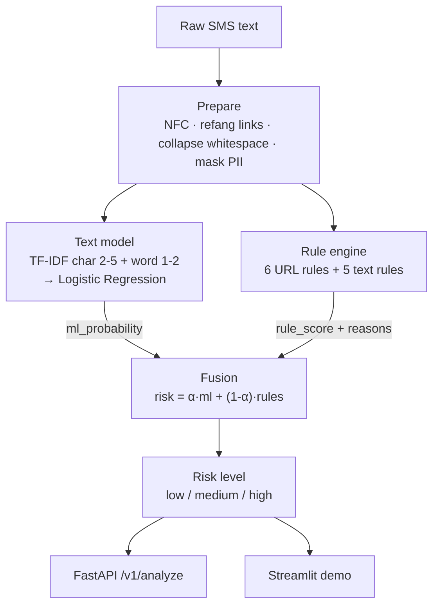
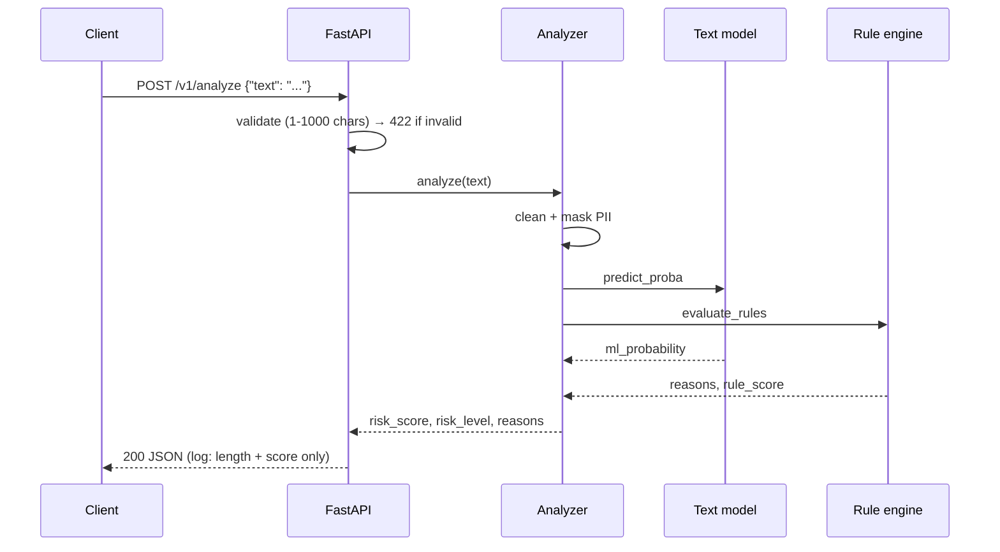
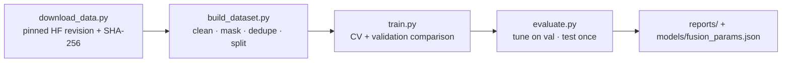

# Architecture

SmishGuard-TR scores a Turkish SMS with two independent components — a text classifier and
a rule engine — and fuses their outputs into one explainable risk assessment.

## Overview

Both the API and the demo call the same `Analyzer` class, so they always return identical
results.

## Components

| Module | Responsibility |
|---|---|
| `data/normalize.py` | Unicode NFC, Turkish lowercasing (`I → ı`, `İ → i`), ASCII folding, refang / defang links |
| `data/anonymize.py` | Masks e-mails, TR IBANs, T.C. identity numbers (checksum), phone numbers; names after honorifics in reports |
| `data/loader.py`, `data/split.py` | Common schema, aggressive deduplication, leakage-safe stratified split (synthetic data train-only) |
| `model/pipeline.py` | `FeatureUnion` of character and word TF-IDF → `LogisticRegression(class_weight="balanced")` |
| `model/train.py`, `model/predict.py` | Cross-validation, model selection, persistence (`joblib` + metadata), top n-grams |
| `features/urls.py` | Finds links (scheme, `www.`, bare domains) and splits hostnames offline with `tldextract` |
| `features/url_features.py` | `BRAND_IMPERSONATION`, `SHORTENER`, `SUSPICIOUS_TLD`, `IP_IN_URL`, `PUNYCODE`, `EXCESSIVE_HYPHENS_DIGITS` |
| `features/text_features.py` | `URGENCY_LANGUAGE`, `MONEY_OR_FINE`, `CREDENTIAL_REQUEST`, `PRIZE_CLAIM`, `ADDRESS_ISSUE` |
| `features/reasons.py` | `Reason(code, weight, message)`, `evaluate_rules`, `rule_score = min(1, Σ weights)` |
| `scoring/fusion.py` | Weighted fusion, level thresholds, tuned parameters in `models/fusion_params.json` |
| `analyzer.py` | Single inference entry point: prepare → model + rules → fusion → `AnalysisResult` |
| `evaluation.py`, `metrics.py` | Threshold / alpha grid search on validation, bootstrap confidence intervals, metrics |
| `api/` | FastAPI app factory, pydantic schemas, lifespan model loading, privacy-preserving logs |
| `config.py` | Every constant: paths, seed, weights, keyword lists, allowlists, thresholds |

## Request flow

## Offline pipeline

## Design principles

- **Explainability first:** every fired rule is a readable reason; the model's top n-grams
  are listed in `reports/metrics_baseline.json`.
- **No network access at inference:** links are parsed as text and never visited; the public
  suffix list is the snapshot bundled with `tldextract`.
- **Honest evaluation:** thresholds and alpha are tuned on validation; the test set is used
  once; confidence intervals are reported (see `docs/DECISIONS.md`, D-010 and D-011).
- **Privacy:** PII is masked before training and inference; message texts are never logged.

Detailed rationale for each choice is recorded in [DECISIONS.md](DECISIONS.md).
